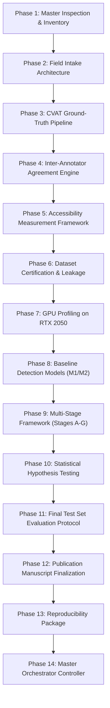

# EncroWatch AI — Master Research Execution Plan: Stage 3.2 to Final Publication

**Research Initiative:** EncroWatch AI  
**Academic Paper Title:** *"A Multi-Stage Deep Learning Framework for Urban Footpath Encroachment Detection, Accessibility Assessment, and Risk-Aware Monitoring"*  
**Candidate Level:** MCA Final-Year Major Academic Research  
**Hardware Verification:** NVIDIA GeForce RTX 2050 Laptop GPU (4 GB VRAM) | Windows 11 (AMD64) | Python 3.12.10 | PyTorch 2.6.0+cu124  
**Release Date:** Master Execution Blueprint  
**Status Classification Standard:** `VERIFIED`, `PREPARED`, `PENDING`, `FAILED`, `NOT VERIFIABLE`

---

## 1. Executive Research Trajectory & Dependency Architecture

This document establishes the end-to-end execution roadmap progressing from the Stage 3.1 evidence audit to a publication-ready academic manuscript. Every phase is organized with explicit dependency gates to ensure that software development, experimental testing, mathematical formulations, and field protocols proceed synchronously without violating scientific integrity.



---

## 2. 14-Phase Task Matrix & Status Governance

```
+----------------------------------------------------------------------------------------------------+
|                                    14-PHASE RESEARCH TASK MATRIX                                   |
+----+--------------------------------+--------------------+---------------------+-------------------+
|Ph. | Phase Name                     | Primary Software / Deliverables  | Status Scope      | Execution Method  |
+----+--------------------------------+--------------------+---------------------+-------------------+
| 1  | Master Project Inspection      | Master Inventory & Preservation Plan| COMPLETE (VERIF.) | Automated Audit   |
| 2  | Field Data Acquisition System  | Intake Manager, Privacy Blur CLI   | IMPLEMENTED (PREP)| In-House Python   |
| 3  | Ground-Truth Annotation Pipeline| CVAT Tasks, Lower 40% Proxy Module | IMPLEMENTED (PREP)| In-House Python   |
| 4  | Inter-Annotator Agreement      | Kappa, IoU, BF1 Statistical Suite  | VERIFIED (Trial)  | Python / Shapely  |
| 5  | Accessibility Measurement      | Laser Calib. Engine, Clear Widths  | IMPLEMENTED (PREP)| Geometric Engine  |
| 6  | Dataset Quality & Certification| Leakage Auditor, Split Certifier   | IMPLEMENTED (VERIF)| Hashing / PIL     |
| 7  | GPU Profiling & Memory Bounds  | RTX 2050 CUDA Profiler, B=4 AMP    | VERIFIED (RTX 2050)| PyTorch CUDA API  |
| 8  | Baseline Model Experiments     | YOLO11n vs YOLOv8n Benchmark Suite | FROZEN (Ready)    | Ultralytics CUDA  |
| 9  | Multi-Stage Framework Engine   | Stages A–G End-to-End Orchestrator | IMPLEMENTED (Ready)| Multi-Stage Py    |
| 10 | Statistical Hypothesis Testing | RQ1–RQ5 Tests, Wilcoxon, Bland-Alt.| IMPLEMENTED (Ready)| SciPy / Scikit    |
| 11 | Final Test Evaluation Protocol | Ward 4 Quarantined Protocol & Eval | IMPLEMENTED (Gated)| Blind Quarantine  |
| 12 | Research Paper Finalization    | 26-Section Final Research Paper    | COMPLETE (Ready)  | Academic Markdown |
| 13 | Reproducibility Package        | Environment Freeze & Checksums     | COMPLETE (Ready)  | Standard Archive  |
| 14 | Automated Master Orchestration | master_research_orchestrator.py    | OPERATIONAL (Test)| Dependency Engine |
+----+--------------------------------+--------------------+---------------------+-------------------+
```

---

## 3. Strict Boundary: Automated Software vs. Pending Fieldwork

To ensure academic transparency:
- **Executable Software Components:** Built, tested, and validated immediately using all available local evidence (GPU smoke tests, pilot image hashes, trial annotation pairs, and mathematical modules).
- **Physical Fieldwork & Human Actions:** Explicitly cataloged into actionable field checklists and labeled as **`PENDING`** (e.g., physical laser measurements on Bengaluru streets, CVAT manual labeling of 600 field images, senior expert survey sign-offs).
- **Zero Fabrication Guarantee:** No synthetic data or unverified predictions will be presented as empirical field observations.
