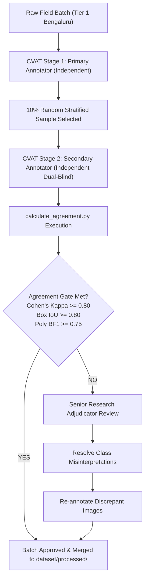

# EncroWatch AI — Stage 1.5: Human Annotation and Quality Verification Protocol

**Research Initiative:** EncroWatch AI  
**Academic Paper Title:** *"A Multi-Stage Deep Learning Framework for Urban Footpath Encroachment Detection, Accessibility Assessment, and Risk-Aware Monitoring"*  
**Candidate Level:** MCA Final-Year Major Academic Research  
**Hardware Verification:** NVIDIA GeForce RTX 2050 Laptop GPU (4 GB VRAM) | Windows 11 (AMD64) | Python 3.12.10 | PyTorch 2.6.0+cu124  
**Document Release:** Stage 1.5 Master Experimental Specification  
**Status:** **ACTIVE / FROZEN FOR TIER 1 BENGALURU ANNOTATION**

---

## 1. Executive Context & Annotation Tool Selection Rationale

The EncroWatch AI framework requires multi-task ground-truth annotations spanning:
1. **Object Detection:** 2D oriented/axis-aligned bounding boxes for 8 custom urban encroachment classes.
2. **Semantic Segmentation:** Dense polygon masks delineating walkable footpath surfaces, roadway corridors, and curb boundary interfaces.
3. **Ground-Plane Contact Delineation:** 2D footprint masks or lower-bound geometric proxies isolating where obstacles physically contact the walking pavement.

### 1.1 Annotation Platform Comparative Evaluation

To select the primary data annotation platform, four leading computer vision annotation suites were evaluated against strict academic and engineering criteria:

| Evaluation Criterion | CVAT (Computer Vision Annotation Tool) | Label Studio | Roboflow | VIA (VGG Image Annotator) |
| :--- | :--- | :--- | :--- | :--- |
| **Licensing & Cost** | Open-source (MIT / Apache 2.0) | Open-source (Apache 2.0) / Enterprise | Commercial freemium | Open-source (BSD-2) |
| **Local Deployment** | Native Docker / Self-hosted | Native Docker / Python pip | Cloud-only (data privacy risks) | Static HTML/JS single file |
| **Polygon / Polyline Tooling** | Excellent (magnetic lasso, spline, polygon) | Good (polygon & brush tools) | Basic (polygon, bounding box) | Basic polygon |
| **Video Tracking Interpolation** | Native Kalman filter / box & poly interpolation | Manual frame-by-frame | Limited video support | None |
| **Multi-User Role Management**| Annotator, Reviewer, Admin roles with assignments | Supported | Supported (cloud) | None (single local user) |
| **Export Formats** | YOLO Darknet, COCO JSON, Pascal VOC, Mask PNG | JSON-MIN, YOLO, Pascal VOC | YOLO, COCO, VOC | CSV, JSON |
| **Offline Privacy Guarantee** | **Complete** (100% air-gapped local server) | **Complete** (local server) | Inadequate (images uploaded) | **Complete** (client browser) |

### 1.2 Final Selection Decision: CVAT

**CVAT (Computer Vision Annotation Tool)** has been selected as the official annotation platform for EncroWatch AI due to:
- **Zero Data Leakage & Total Privacy:** Fully deployable in a local Docker container or isolated server, guaranteeing compliance with field privacy rules (preventing third-party cloud exposure of unblurred pedestrian faces or vehicle license plates).
- **Precision Polygon & Polyline Engines:** Advanced vertex snapping and spline interpolation essential for non-rectilinear, curvilinear Indian urban curbs and footpath edges.
- **Sequential Video Tracking Interpolation:** Enables efficient frame annotation for temporal video sequences (Target Tier 3), reducing annotation overhead by ~65% via automated linear interpolation of bounding boxes.
- **Reviewer-Annotator Escalation Ladder:** Built-in task assignment, status tracking, and rejection workflows required to enforce the dual-annotation inter-annotator agreement protocol.

---

## 2. Formal Annotation Guidelines for the 8 Custom Encroachment Classes

All annotations must adhere strictly to the ontology defined in [`dataset/metadata/classes.json`](file:///C:/Users/Darshan%20B/.gemini/antigravity/scratch/encrowatch-ai/dataset/metadata/classes.json). Annotators must not merge classes or introduce ad-hoc labels.

```
+----------------------------------------------------------------------------------------------------+
|                                    ENCROWATCH AI CLASS ONTOLOGY                                    |
+----+-----------------------+-----------------------------+--------------------+--------------------+
| ID | Class Name            | Primary Physical Attributes | Dynamic / Static   | Ground Contact     |
+----+-----------------------+-----------------------------+--------------------+--------------------+
| 0  | motorcycle            | Two-wheelers, scooters      | Static (Parked)    | Dual tire contact  |
| 1  | car                   | Four-wheelers, autos, vans  | Static (Parked)    | 4 tire footprints  |
| 2  | vendor_cart           | Pushcarts, thelas, kiosks   | Semi-Static        | Wheel / leg base   |
| 3  | construction_debris   | Sand, gravel, bricks, rubble| Static (Hazardous) | Surface polygon    |
| 4  | commercial_signboard  | A-frame boards, flex stands | Static (Removable) | Stand / base plate |
| 5  | shop_extension        | Racks, display tables, crates| Static (Fixed)    | Stand / box base   |
| 6  | umbrella_canopy       | Tarpaulins, shade umbrellas | Overhead / Cantil. | Vertical clearance |
| 7  | pedestrian            | Walking or standing humans  | Dynamic            | Shoe contact       |
+----+-----------------------+-----------------------------+--------------------+--------------------+
```

### 2.1 Detailed Class Annotation Specifications

1. **`motorcycle` (ID 0):**
   - **Scope:** Includes all two-wheeled motorized vehicles (motorcycles, scooters, mopeds) and bicycles that are stationary or parked on the footpath corridor or curb interface.
   - **Bounding Box Rule:** Tightly enclose the complete vehicle silhouette including mirrors, rear rack, and kickstand.
   - **Exclusion:** Moving two-wheelers in the active vehicular roadway must *not* be annotated unless they actively mount or drive over the sidewalk.

2. **`car` (ID 1):**
   - **Scope:** Four-wheeled passenger cars, auto-rickshaws, utility vans, and light commercial vehicles parked partially or fully on the footpath.
   - **Bounding Box Rule:** Tightly enclose the visible body, bumpers, and side mirrors.
   - **Truncation Rule:** If partially cut off by the image boundary, annotate up to the image edge with the `partial_obstruction` tag.

3. **`vendor_cart` (ID 2):**
   - **Scope:** Mobile vending stalls, four-wheel handcarts (*thelas*), wooden fruit/vegetable carts, and food kiosks.
   - **Bounding Box Rule:** Enclose the cart body, wheels, push handles, and goods displayed *on* the cart.
   - **Sub-Component Rule:** If a large umbrella is mounted directly to the cart, the cart body is annotated as `vendor_cart` and the umbrella shade is annotated separately as `umbrella_canopy` to permit clearance analysis.

4. **`construction_debris` (ID 3):**
   - **Scope:** Piles of unpaved construction aggregate, sand mounds, brick stacks, discarded concrete pavers, exposed electrical conduits, and open digging rubble.
   - **Annotation Geometry:** Must be annotated as both a 2D bounding box (for YOLO baseline) and a precise multi-point polygon enclosing the boundary of the debris scatter on the walking surface.
   - **Threshold:** Dispersed litter smaller than $0.15\text{ m} \times 0.15\text{ m}$ is excluded; continuous piles exceeding $0.30\text{ m}$ in width or depth are mandatory.

5. **`commercial_signboard` (ID 4):**
   - **Scope:** Movable advertising boards, A-frame sandwich boards, metal promotional display racks, and free-standing banners placed on the walkway.
   - **Bounding Box Rule:** Enclose both the display face and the supporting legs/weighted base.
   - **Exclusion:** Permanent signs affixed flat to building walls at heights $> 2.20\text{ m}$ are excluded.

6. **`shop_extension` (ID 5):**
   - **Scope:** Permanent or semi-permanent commercial spillover from formal storefronts: display tables, milk-crate stacks, clothing racks, grocery bins, and ramps extending past the legal property line onto the footpath.
   - **Bounding Box Rule:** Enclose the entire extruded display structure up to the physical building facade.

7. **`umbrella_canopy` (ID 6):**
   - **Scope:** Cantilevered shop awnings, horizontal plastic/canvas tarpaulins, and large stationary vendor sun umbrellas projecting horizontally over the pedestrian walkway.
   - **Bounding Box Rule:** Tightly enclose the perimeter of the overhead shade structure.
   - **Clearance Gating:** Annotators must evaluate vertical head clearance against the $2.20\text{ m}$ threshold (see Section 4).

8. **`pedestrian` (ID 7):**
   - **Scope:** Humans present within the scene, walking, standing, or sitting.
   - **Bounding Box Rule:** Enclose the full human figure from head to toe. If carrying backpacks or umbrellas, include them in the bounding box.
   - **Research Role:** Pedestrians serve as a non-obstacle reference class to evaluate whether detection models confuse lawful sidewalk users with encroachments, and to monitor spillover into vehicular roadway lanes.

---

## 3. Corridor Polygon Annotation Specifications

Corridor delineation models (Stage 2.4 / Module M3) require pixel-level segmentation masks for spatial overlap and geometric accessibility calculations.

```
+----------------------------------------------------------------------------------------------------+
|                                    CORRIDOR SEGMENTATION SCHEME                                    |
+----------------------------------------------------------------------------------------------------+
|  [ BUILDING FRONTAL BOUNDARY ]                                                                     |
|  ................................................................................................  |
|  [ FOOTPATH CORRIDOR (POLYGON) ]  --> Class: footpath_corridor (Color: Green, Hex: #00FF00)         |
|      - Encloses all paved, tiled, or dirt sidewalk surfaces designated for walking                 |
|      - Continuous polygon spanning unobstructed walking surface and area under encroachments        |
|  ================================================================================================  |
|  [ CURB BOUNDARY (POLYLINE) ]     --> Class: curb_boundary (Color: Yellow, Hex: #FFFF00)           |
|      - Explicit 2-3 pixel wide linear edge marking elevation change between footpath and road      |
|  ------------------------------------------------------------------------------------------------  |
|  [ ROADWAY CORRIDOR (POLYGON) ]   --> Class: roadway_corridor (Color: Red, Hex: #FF0000)           |
|      - Encloses active vehicular asphalt lane immediately adjacent to curb                         |
+----------------------------------------------------------------------------------------------------+
```

### 3.1 Footpath Polygon Delineation Rules
1. **Underlying Footpath Surface:** The footpath polygon must delineate the *nominal designated sidewalk area*, tracing behind or beneath encroaching objects where visibility allows, rather than cutting around obstacles. This ensures that spatial encroachment overlap:
   $$\text{Encroachment Ratio} = \frac{\text{Area}(\text{Obstacle Footprint} \cap \text{Footpath Corridor})}{\text{Area}(\text{Footpath Corridor})}$$
   can be accurately computed.
2. **Vertex Density:** Place polygon vertices every $10–25\text{ pixels}$ along curved boundaries and at every sharp directional deflection. Straight curb edges require only vertex endpoints.
3. **Occlusion Handling:** When the curb edge is occluded by a parked car or vendor cart, the annotator must interpolate the linear continuation along the vanishing line.

---

## 4. Ground-Contact Mechanics & Canopy Clearance Rules

Accurate spatial encroachment calculation demands knowing *where* an obstacle occupies the ground surface, not merely its 2D visual silhouette.

### 4.1 Ground-Plane Contact vs. Bounding Box Dilemma

A 2D bounding box around a car or vendor cart includes empty air, windshields, and elevated canopies. Treating the entire bounding box as a ground footprint leads to massive false positives (e.g., claiming a car parked in the roadway encroaches on the sidewalk because its side mirror overhangs the bounding box).

```
   Visual Bounding Box (YOLO)                     True Physical Contact Footprint
+-------------------------------+              +-------------------------------+
|         [ Cart Canopy ]       |              |                               |
|        /               \      |              |                               |
|       /  Merchandise    \     |              |                               |
|      +-------------------+    |              |                               |
|      |    Table Body     |    |              |                               |
|      +-------------------+    |              |                               |
|          |     |     |        |              |          |     |     |        |
|        [===] [===] [===]      |              |        [===] [===] [===]      |
+--------(***)-(***)-(***)------+              +--------(***)-(***)-(***)------+
       Ground Intersection                            Actual Footprints Only
```

### 4.2 Lower 40% Bounding Box Proxy Heuristic

For rigid upright 3D obstacles (motorcycles, cars, vendor carts, signboards, shop displays) where precise ground segmentation is unavailable or partially occluded, EncroWatch AI defines a formal geometric proxy:

$$\text{Footprint}_{\text{proxy}} = \left\{ (x, y) \in \mathcal{B} \;\middle|\; y \ge y_{\max} - 0.40 \cdot h_{\mathcal{B}} \right\}$$

Where:
- $\mathcal{B} = [x_{\min}, y_{\min}, x_{\max}, y_{\max}]$ is the 2D bounding box.
- $h_{\mathcal{B}} = y_{\max} - y_{\min}$ is the total bounding box height.
- The lower 40% vertical slice captures the wheels, base struts, and true ground-interface plane while discarding high-altitude visual noise.

### 4.3 Canopy Head-Clearance Gating Rule ($2.20\text{ m}$)

In accordance with the **Indian Road Congress Guidelines for Pedestrian Facilities (IRC:103-2012)**:
- Standard vertical walking clearance required on urban walkways is **$2.20\text{ metres}$**.
- **Canopy Gating Rule:**
  - Overhead canopies, shop awnings, and hanging commercial signs with vertical clearance $h_{\text{clear}} \ge 2.20\text{ m}$ from the pavement surface do **not** impede pedestrian passage and are classified as **Non-Encroaching Overhead Features** (`clearance_compliant`).
  - Any canopy, sagging tarpaulin, or signboard with vertical clearance $h_{\text{clear}} < 2.20\text{ m}$ forces pedestrians to duck or divert and is classified as an **Active Head-Clearance Encroachment** (`head_clearance_hazard`).

---

## 5. Quality Assurance, Uncertainty Tags, and Adjudication Ladder

### 5.1 Mandatory Manual Uncertainty Tags

Annotators must attach one or more standard metadata flags when visual ambiguity exists:

```
+------------------------------+--------------------------------------------------------------------+
| Uncertainty Flag             | Trigger Condition & Operational Protocol                           |
+------------------------------+--------------------------------------------------------------------+
| ambiguous_boundary           | Blurred curb, unpaved dirt transition, heavy shadow obfuscation.  |
| occluded_ground_contact      | Tires or cart legs hidden behind another object or dense crowd.    |
| partial_obstruction          | Object extends beyond the image frame edge (truncated).          |
| low_light_flare              | Severe headlight blooming, dusk glare, or underexposed deep shadow.|
+------------------------------+--------------------------------------------------------------------+
```

### 5.2 Quality Ladder and Adjudication Workflow



1. **Step 1:** Annotator 1 annotates 100% of the assigned ward batch.
2. **Step 2:** A 10% stratified random subset (covering all 8 classes) is assigned blindly to Annotator 2.
3. **Step 3:** The automated agreement engine (`scripts/annotation_validation/calculate_agreement.py`) evaluates Cohen's Kappa, Bounding Box IoU, and Boundary F1.
4. **Step 4:** Batches meeting all three thresholds ($\kappa \ge 0.80$, $\text{IoU} \ge 0.80$, $\text{BF1} \ge 0.75$) are formally certified.
5. **Step 5:** Any batch failing the thresholds is held; the Senior Academic Reviewer convenes an adjudication session to arbitrate boundary discrepancies and update guideline definitions before final sign-off.

---

> [!IMPORTANT]
> **Academic Integrity Mandate:** Synthetic model predictions must **never** be injected into CVAT as ground truth without full human verification. Pre-annotated legacy boxes with visual overlays (quarantined in Stage 1.2) must remain excluded from training splits.
