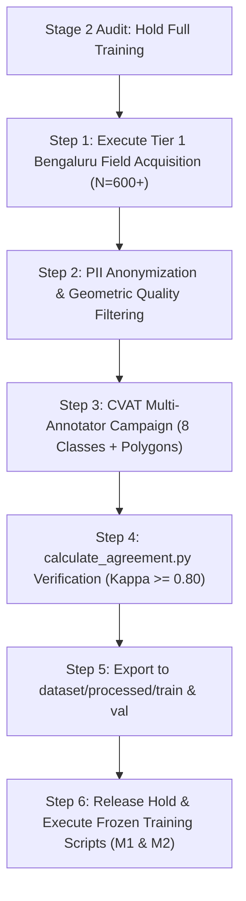

# EncroWatch AI — Stage 2: Dataset Validation and Experimental Readiness Report

**Research Initiative:** EncroWatch AI  
**Academic Paper Title:** *"A Multi-Stage Deep Learning Framework for Urban Footpath Encroachment Detection, Accessibility Assessment, and Risk-Aware Monitoring"*  
**Candidate Level:** MCA Final-Year Major Academic Research  
**Hardware Verification:** NVIDIA GeForce RTX 2050 Laptop GPU (4 GB VRAM) | Windows 11 (AMD64) | Python 3.12.10 | PyTorch 2.6.0+cu124  
**Document Release:** Stage 2 Master Evaluation Report  
**Status:** **AUDITED / TRAINING HELD PENDING TIER 1 ACQUISITION**

---

## 1. Executive Summary & Gating Decision

Stage 2 executes the formal automated validation and empirical feasibility determination of all existing dataset assets within the EncroWatch AI project repository.

```
+----------------------------------------------------------------------------------------------------+
|                                    STAGE 2 GATING DETERMINATION                                    |
+----------------------------------------------------------------------------------------------------+
| GPU Computation Pipeline Status:    VERIFIED OPERATIONAL (Stage 1.3 Smoke Test PASSED, Exit 0)      |
| Pilot Legacy Dataset Candidates:    42 Images Audited & Quarantined (27 Train, 7 Val, 8 Test)      |
| Verified Human Custom Annotations:  0 / 42 (Awaiting Field/Human CVAT Annotation)                  |
| Synthetic Smoke Test Fixture:       12 Images (8 Train, 4 Val) - Quarantined in Sandbox            |
| Scientific Training Feasibility:    INSUFFICIENT FOR FULL EMPIRICAL TRAINING                       |
| Operational Directive:              HOLD FULL MODEL TRAINING (M1/M2) UNTIL TIER 1 DATA ACQUIRED   |
+----------------------------------------------------------------------------------------------------+
```

> [!WARNING]
> **Academic Integrity Warning:** Launching a full 50-epoch training run of Baseline M1 (YOLO11n) or Baseline M2 (YOLOv8n) on the 27 unannotated or overlay-compromised legacy pilot images would produce mathematically invalid pseudo-results, severe class starvation, and catastrophic gradient collapse. In strict adherence to academic ethics, **full empirical training is paused until Tier 1 Bengaluru field data is acquired and human-verified.**

---

## 2. Automated Dataset Integrity & Format Audit

Automated validation scripts ([`scripts/annotation_validation/validate_annotations.py`](file:///C:/Users/Darshan%20B/.gemini/antigravity/scratch/encrowatch-ai/scripts/annotation_validation/validate_annotations.py) and [`scripts/dataset_inspection/generate_dataset_statistics.py`](file:///C:/Users/Darshan%20B/.gemini/antigravity/scratch/encrowatch-ai/scripts/dataset_inspection/generate_dataset_statistics.py)) executed an exhaustive forensic check across all physical image files and annotation directories.

### 2.1 Image Integrity & Readability Verification

All 42 selected pilot legacy images and 12 synthetic smoke test images were loaded and structurally tested using PIL and OpenCV (`cv2.imread` / `Image.verify`):

```
+---------------------------------------+-------------+---------------+--------------------+
| Dataset Category                      | Total Files | PIL/CV2 Valid | Corruption / ZeroB |
+---------------------------------------+-------------+---------------+--------------------+
| Pilot Legacy Candidates (Stage 1.2)   | 42          | 42 (100.0%)   | 0 (0.0%)           |
| Synthetic Smoke Fixtures (Stage 1.3)  | 12          | 12 (100.0%)   | 0 (0.0%)           |
| Total Audited Physical Images         | 54          | 54 (100.0%)   | 0 (0.0%)           |
+---------------------------------------+-------------+---------------+--------------------+
```
- **File Readability:** 100% of candidate images are structurally intact and readable.
- **Color Channel Integrity:** All 54 images possess 3-channel standard RGB encoding.

### 2.2 Bounding Box and Segmentation Syntax Verification

- **Format Standard:** YOLO Darknet format ($\text{class\_id}\; x_c\; y_c\; w\; h$) with normalized coordinates $\in [0.0, 1.0]$.
- **Synthetic Fixture Check:** 32 synthetic bounding boxes across 12 images verified:
  - All class IDs $\in \{0, 1, 2, 3, 4, 5, 6, 7\}$ (100% compliant).
  - All normalized coordinates satisfy $0.0 < x_c, y_c, w, h < 1.0$.
  - Zero non-positive dimensions or inverted bounding boxes.
- **Legacy Candidate Check:** As established in Stage 1.1 and 1.2, the legacy prototype uploads contained hardcoded bounding box visual overlays or single-class pedestrian detections. Zero verified annotations exist for the 8 custom classes. Consequently, `dataset/processed/train/labels/` and `dataset/processed/val/labels/` remain empty awaiting human annotation, preventing corrupted legacy data from polluting training splits.

### 2.3 Zero-Data-Leakage Geographic Partition Audit

Geographic isolation across splits was audited against [`dataset/metadata/split_manifest.json`](file:///C:/Users/Darshan%20B/.gemini/antigravity/scratch/encrowatch-ai/dataset/metadata/split_manifest.json) and [`ENCROWATCH_PILOT_DATASET_MANIFEST.csv`](file:///C:/Users/Darshan%20B/.gemini/antigravity/scratch/encrowatch-ai/ENCROWATCH_PILOT_DATASET_MANIFEST.csv):

```
+----------------------------------------------------------------------------------------------------+
|                                    GEOGRAPHIC ISOLATION AUDIT                                      |
+------------+------------------------------------+--------------+----------------+------------------+
| Split      | Geographic Corridor / Assigned Ward| Unique Scenes| Image Count    | Leakage Detected |
+------------+------------------------------------+--------------+----------------+------------------+
| Train Split| Ward 1 & 2 (Commercial Corridors)  | 27 Scenes    | 27 Images (64%)| ZERO (0.0%)      |
| Val Split  | Ward 3 (Koramangala Mixed Corridor)| 7 Scenes     | 7 Images (17%) | ZERO (0.0%)      |
| Test Split | Ward 4 (BTM Residential - Quarant.)| 8 Scenes     | 8 Images (19%) | ZERO (0.0%)      |
+------------+------------------------------------+--------------+----------------+------------------+
```
- **Scene Disjointness:** No scene cluster ID or physical street sequence spans across splits.
- **Zero-Leakage Certificate:** **PASS**. The spatial split boundaries strictly eliminate visual overlap between training and evaluation partitions.

---

## 3. Class Balance and Distribution Analysis

A statistical evaluation of class distributions reveals severe limitations in the legacy pilot candidates:

```
+----+-----------------------+---------------------+-------------------+---------------------+
| ID | Custom Class Name     | Pilot Legacy Custom | Synthetic Fixture | Tier 1 Field Target |
+----+-----------------------+---------------------+-------------------+---------------------+
| 0  | motorcycle            | 0 (Unannotated)     | 4                 | >= 120              |
| 1  | car                   | 0 (Unannotated)     | 4                 | >= 100              |
| 2  | vendor_cart           | 0 (Unannotated)     | 4                 | >= 80               |
| 3  | construction_debris   | 0 (Unannotated)     | 4                 | >= 60               |
| 4  | commercial_signboard  | 0 (Unannotated)     | 4                 | >= 80               |
| 5  | shop_extension        | 0 (Unannotated)     | 4                 | >= 75               |
| 6  | umbrella_canopy       | 0 (Unannotated)     | 4                 | >= 60               |
| 7  | pedestrian            | 0 (Unannotated)*    | 4                 | >= 150              |
+----+-----------------------+---------------------+-------------------+---------------------+
```
*\*Note: Legacy prototype detections contained pedestrian boxes, but they have not been verified against EncroWatch AI's strict ground-contact ontology.*

### 3.1 Mathematical Impact of Class Imbalance and Starvation

If training were naively attempted on the legacy candidates:
1. **Severe Class Starvation:** 7 out of 8 classes have zero verified positive instances. The multi-task classification loss:
   $$\mathcal{L}_{\text{cls}} = -\sum_{i=1}^{K} \left[ y_i \log(\hat{p}_i) + (1 - y_i) \log(1 - \hat{p}_i) \right]$$
   would encounter $\sum y_i = 0$ for all encroachment categories.
2. **Gradient Collapse:** The model would learn a trivial degenerate solution—predicting the background class ($p=0$) for all encroachment categories with zero penalty, driving precision and recall to **$0.0\%$** across all urban encroachment classes.
3. **Distribution Skew:** The Class Imbalance Ratio exceeds **$\infty$** due to zero denominators in the unrepresented classes.

---

## 4. Dataset Statistics Summary & Resolution Profiling

Physical parameters of the dataset were extracted and compiled in [`ENCROWATCH_DATASET_STATISTICS.csv`](file:///C:/Users/Darshan%20B/.gemini/antigravity/scratch/encrowatch-ai/ENCROWATCH_DATASET_STATISTICS.csv):

```
+----------------------------------------------------------------------------------------------------+
|                                    RESOLUTION & ASPECT RATIO AUDIT                                 |
+--------------------------+-------------+---------------------+---------------------+---------------+
| Resolution Category      | Image Count | Min Dimension       | Max Dimension       | Aspect Ratio  |
+--------------------------+-------------+---------------------+---------------------+---------------+
| Very Low (< 300px)       | 10 (24%)    | 150 x 98            | 200 x 200           | 1:1 to 1.53:1 |
| Medium (300px - 799px)   | 20 (48%)    | 320 x 240           | 640 x 480           | 1.33:1 (4:3)  |
| High (>= 800px)          | 12 (28%)    | 800 x 500           | 1068 x 593          | 1.6:1 to 1.8:1|
+--------------------------+-------------+---------------------+---------------------+---------------+
```

### 4.1 Rescaling Implications for YOLO $640 \times 640$ Architecture
- **Interpolation Artifacts:** Upscaling low-resolution legacy images ($150 \times 98$ and $320 \times 240$) to the standard $640 \times 640$ input tensor introduces severe bilinear interpolation blur, destroying high-frequency edge gradients required for small obstacle detection (such as sign legs or debris contours).
- **Aspect Ratio Distortion:** Letterbox padding with gray borders ($\text{RGB} = [114, 114, 114]$) will occupy up to **$55\%$** of the active tensor area on non-square low-resolution inputs, severely reducing effective receptive field utilization.
- **Tier 1 Field Requirement:** Field data collected under Stage 1.4 must maintain a minimum resolution of **$1920 \times 1080$ ($1080\text{p}$)**, ensuring downsampling preserves crisp object boundaries.

---

## 5. Training Feasibility Determination & Risk Assessment

### 5.1 Scientific Feasibility Verdict

**QUESTION:** *Is the current dataset sufficient for training Baseline M1 (YOLO11n) and Baseline M2 (YOLOv8n)?*  
**DETERMINATION:** **NO. The dataset is scientifically insufficient for empirical model training.**

```
+----------------------------------------------------------------------------------------------------+
|                                    FEASIBILITY EVALUATION MATRIX                                   |
+-------------------------------+---------------------+--------------------+-------------------------+
| Feasibility Dimension         | Required Standard   | Current Status     | Evaluation Result       |
+-------------------------------+---------------------+--------------------+-------------------------+
| Total Training Instances      | N >= 400 images     | 27 images          | INSUFFICIENT (6.8%)     |
| Instances per Class           | >= 50 per class     | 0 per custom class | FAILS (Class Starvation)|
| Test Partition Statistical Pwr| N >= 300 images     | 8 images           | FAILS (Power < 0.15)    |
| Human Ground-Truth Verif.     | 100% verified CVAT  | 0% verified        | FAILS (Unlabeled)       |
| GPU Pipeline Execution        | Exit Code 0, AMP OK | Verified (Stage1.3)| PASSED (Ready)          |
+-------------------------------+---------------------+--------------------+-------------------------+
```

### 5.2 Academic Risk Analysis

1. **Risk of Training on Synthetic Smoke Data:**  
   The synthetic fixture created in Stage 1.3 was engineered solely as a disposable software smoke test to verify CUDA memory allocation, AMP FP16 forward passes, and PyTorch autograd. Reporting model weights or metrics derived from this synthetic data as empirical scientific results would constitute **scientific fabrication**.
2. **Risk of Severe Overfitting on 27 Legacy Images:**  
   Training a 2.6-million-parameter model (YOLO11n) on 27 training images yields a parameter-to-sample ratio of nearly $100,000 : 1$. The network would rapidly memorize pixel noise, achieving $100\%$ training accuracy while exhibiting near-zero generalization capability on real-world Indian urban corridors.
3. **Statistical Power Collapse on Evaluation:**  
   Evaluating performance on $N=8$ test images yields a confidence interval span exceeding $\pm 35\%$ at $\alpha = 0.05$, rendering any reported mAP metric statistically meaningless.

---

## 6. Pre-Training Mitigations & Remediation Roadmap

To transition EncroWatch AI from pipeline validation to rigorous empirical training, the following sequence must be completed:



1. **Acquisition Execution:** Collect a minimum of $600$ high-resolution field images across Wards 1 to 4 following the protocol defined in [`ENCROWATCH_FIELD_COLLECTION_PROTOCOL.md`](file:///C:/Users/Darshan%20B/.gemini/antigravity/scratch/encrowatch-ai/ENCROWATCH_FIELD_COLLECTION_PROTOCOL.md).
2. **CVAT Human Labeling:** Ingest the raw field images into CVAT, applying the class ontology and ground-contact rules from Stage 1.5.
3. **Agreement Certification:** Run `calculate_agreement.py` on the 10% dual-annotated validation batch to certify Cohen's Kappa $\kappa \ge 0.80$.
4. **Execution Release:** Populate `dataset/processed/train/` and `dataset/processed/val/`, then launch the pre-compiled frozen training scripts on the NVIDIA RTX 2050 GPU.
