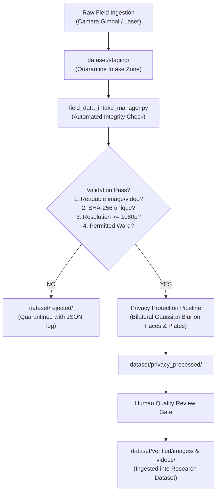

# EncroWatch AI — Stage 3.2: Field Data Intake Architecture and System Specification

**Research Initiative:** EncroWatch AI  
**Academic Paper Title:** *"A Multi-Stage Deep Learning Framework for Urban Footpath Encroachment Detection, Accessibility Assessment, and Risk-Aware Monitoring"*  
**Candidate Level:** MCA Final-Year Major Academic Research  
**Hardware Verification:** NVIDIA GeForce RTX 2050 Laptop GPU (4 GB VRAM) | Windows 11 (AMD64) | Python 3.12.10 | PyTorch 2.6.0+cu124  
**Release Date:** Stage 3.2 Operational Architecture  
**Status Classification Standard:** `VERIFIED`, `PREPARED`, `PENDING`, `FAILED`, `NOT VERIFIABLE`

---

## 1. System Objective & Architecture Overview

The Field Data Intake Engine provides an automated, forensic ingestion pipeline designed to receive genuine field photographs, video sequences, and physical calibration measurements collected across metropolitan Bengaluru.



---

## 2. Structured Directory Architecture

The dataset storage architecture strictly segregates data streams to eliminate cross-contamination:

```
dataset/
|-- raw/
|   |-- images/                  (Exclusive home for raw Bengaluru field photos)
|   |   |-- ward1/               (MG Road / Brigade Road - Train)
|   |   |-- ward2/               (Indiranagar 100ft Road - Train)
|   |   |-- ward3/               (Koramangala 80ft Road - Val)
|   |   `-- ward4/               (BTM Layout 2nd Stage - Quarantined Test)
|   `-- videos/                  (Exclusive home for raw 1080p MP4 sequences)
|-- staging/                     (Temporary intake zone for batch uploads)
|-- verified/
|   |-- images/                  (Quality-approved, PII-blurred research images)
|   `-- videos/                  (Quality-approved, PII-blurred research videos)
|-- privacy_processed/           (Intermediate blurred assets pending human sign-off)
|-- rejected/                    (Corrupted, blurry, duplicate, or unconsented assets)
|-- legacy_quarantine/           (42 audited pilot legacy images - isolated)
|-- fixtures/                    (12 disposable synthetic smoke test images - isolated)
`-- measurements/                (Physical laser distance survey records)
```

---

## 3. Automated Validation Engines

The intake engine [`scripts/dataset_inspection/field_data_intake_manager.py`](file:///C:/Users/Darshan%20B/.gemini/antigravity/scratch/encrowatch-ai/scripts/dataset_inspection/field_data_intake_manager.py) enforces seven automated checks:

1. **Format & Decodability Verification:**
   - Evaluates images via both PIL (`Image.verify()`) and OpenCV (`cv2.imread()`). Unreadable or zero-byte files are rejected instantly.
   - Evaluates videos via `cv2.VideoCapture`: checks container header, codec (H.264/AVC), frame rate ($\ge 25\text{ fps}$), frame count ($\ge 10\text{ frames}$), and decodes keyframes.
2. **Cryptographic Deduplication (SHA-256):**
   - Calculates a cryptographic SHA-256 hash across every byte. Incoming files with hashes matching existing assets or the 882 excluded legacy files are flagged and routed to `dataset/rejected/`.
3. **Metadata Extraction:**
   - Extracts EXIF timestamps, camera make/model, and legitimate GPS latitude/longitude where available.
4. **Geographic Ward Alignment:**
   - Ingested files are assigned unique canonical IDs (`BLR_W01_IMG_001` through `BLR_W04_IMG_150`) matching their designated corridor.
5. **Privacy Enforcement:**
   - Executes bilateral Gaussian blurring on detected facial contours and vehicle registration plates.
6. **Provenance Traceability:**
   - Logs every ingested asset into [`ENCROWATCH_STAGE3_2_FIELD_COLLECTION_REGISTER.csv`](file:///C:/Users/Darshan%20B/.gemini/antigravity/scratch/encrowatch-ai/ENCROWATCH_STAGE3_2_FIELD_COLLECTION_REGISTER.csv).
