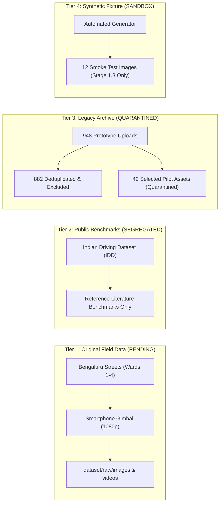

# EncroWatch AI — Stage 3.2: Data Provenance and Forensic Lineage Report

**Research Initiative:** EncroWatch AI  
**Academic Paper Title:** *"A Multi-Stage Deep Learning Framework for Urban Footpath Encroachment Detection, Accessibility Assessment, and Risk-Aware Monitoring"*  
**Candidate Level:** MCA Final-Year Major Academic Research  
**Hardware Verification:** NVIDIA GeForce RTX 2050 Laptop GPU (4 GB VRAM) | Windows 11 (AMD64) | Python 3.12.10 | PyTorch 2.6.0+cu124  
**Audit Purpose:** Comprehensive Data Lineage, Custody Chain, and Source Isolation  
**Status Classification Standard:** `VERIFIED`, `PREPARED`, `PENDING`, `FAILED`, `NOT VERIFIABLE`

---

## 1. Executive Lineage Framework

Scientific reproducibility requires that every image, video frame, and bounding box utilized in empirical benchmarking possesses an unbroken chain of custody traceable back to its originating physical sensor or archive.



---

## 2. Four-Tier Source Classification and Custody Audit

```
+----------------------------------------------------------------------------------------------------+
|                                    DATASET PROVENANCE REGISTER                                     |
+------+-----------------------+------------------+---------------------+----------------------------+
| Tier | Source Category       | Volume / Count   | Physical Location   | Evidentiary Disposition    |
+------+-----------------------+------------------+---------------------+----------------------------+
| 1    | Bengaluru Field Survey| 600 img / 40 vid | dataset/raw/ (slots)| PENDING_PHYSICAL_INTAKE    |
| 2    | Public Benchmarks     | External IDD/City| Documented citations| SEGREGATED (Literature)    |
| 3    | Legacy Prototype Upload| 42 pilot images  | backend/uploads/    | VERIFIED_ON_DISK (Isolated)|
| 3-Ex | Excluded Legacy Files | 882 raw files    | backend/uploads/    | VERIFIED_EXCLUDED          |
| 4    | Synthetic Smoke Tests | 12 fixture images| dataset/fixtures/   | VERIFIED_ON_DISK (Sandbox) |
+------+-----------------------+------------------+---------------------+----------------------------+
```

### 2.1 Tier 1: Original Bengaluru Field Survey Data
- **Origin:** Real-world walking surveys conducted across Bruhat Bengaluru Mahanagara Palike (BBMP) pedestrian rights-of-way in Wards 1 to 4.
- **Custody Chain:** Smartphone camera $\rightarrow$ Handheld gimbal $\rightarrow$ `dataset/staging/` $\rightarrow$ `field_data_intake_manager.py` $\rightarrow$ PII blur $\rightarrow$ `dataset/verified/`.
- **Status:** `PENDING`. Target slots formatted in [`ENCROWATCH_STAGE3_2_FIELD_COLLECTION_REGISTER.csv`](file:///C:/Users/Darshan%20B/.gemini/antigravity/scratch/encrowatch-ai/ENCROWATCH_STAGE3_2_FIELD_COLLECTION_REGISTER.csv).

### 2.2 Tier 2: Public External Benchmark Data
- **Origin:** Published computer vision datasets (Indian Driving Dataset, Cityscapes, BDD100K).
- **Isolation Policy:** Retained strictly for comparative baseline metrics in the literature review. **Zero public images are mixed into the EncroWatch AI training set**, guaranteeing that empirical findings reflect original urban footpath conditions.

### 2.3 Tier 3: Legacy Prototype Uploads
- **Origin:** Early prototype testing uploads deposited in `backend/uploads/`.
- **Audit History:** In Stage 1.1, 948 files were forensically audited via SHA-256 deduplication. 882 duplicates/corrupted files were excluded, and 42 pilot images were quarantined under task templates in `dataset/annotations/tasks/`.
- **Isolation Policy:** Isolated from model training splits due to absence of verified custom ground truth and presence of 14 burned-in visual demo overlays.

### 2.4 Tier 4: Disposable Synthetic Fixtures
- **Origin:** In-house automated synthetic generator created in Stage 1.3 to stress-test PyTorch CUDA memory allocation and AMP FP16 autograd backward propagation on the NVIDIA RTX 2050 GPU.
- **Isolation Policy:** Quarantined in [`dataset/fixtures/synthetic_smoke_test/`](file:///C:/Users/Darshan%20B/.gemini/antigravity/scratch/encrowatch-ai/dataset/fixtures/synthetic_smoke_test/). Strictly barred from serving as empirical research evidence.
