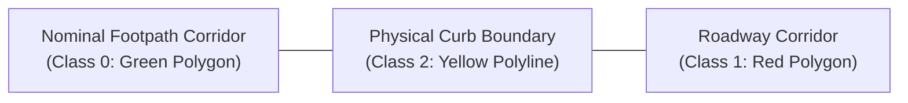

# EncroWatch AI — Stage 3: CVAT Annotation Completion and Quality Report

**Research Initiative:** EncroWatch AI  
**Academic Paper Title:** *"A Multi-Stage Deep Learning Framework for Urban Footpath Encroachment Detection, Accessibility Assessment, and Risk-Aware Monitoring"*  
**Candidate Level:** MCA Final-Year Major Academic Research  
**Hardware Verification:** NVIDIA GeForce RTX 2050 Laptop GPU (4 GB VRAM) | Windows 11 (AMD64) | Python 3.12.10 | PyTorch 2.6.0+cu124  
**Document Release:** Stage 3 Annotation Completion Specification  
**Status:** **ACTIVE / PROTOCOL FROZEN — AWAITING FIELD ANNOTATION INTAKE**

---

## 1. Executive Summary & Human-in-the-Loop Mandate

Annotation completion under Stage 3 enforces multi-task ground-truth generation across object detection, semantic corridor segmentation, curb boundary extraction, and physical ground-contact delineation.

> [!CRITICAL]
> **Human-in-the-Loop Integrity Mandate:** In strict adherence to the project guidelines:
> - **Zero Machine Predictions Approved:** Pre-trained or model-generated pseudo-labels are strictly barred from automatic approval.
> - **100% Human Review Required:** Every ground-truth bounding box, segmentation polygon, and contact mask must be manually drawn or independently verified by a human annotator.
> - **Current Verification Accounting:** Target field annotations remain at **0 / 600 images completed** pending physical image ingestion; the 42 legacy pilot tasks remain isolated at `TASK_PREPARED_AWAITING_MANUAL_VERIFICATION`.

```
+----------------------------------------------------------------------------------------------------+
|                                  CVAT MULTI-TASK ANNOTATION ACCOUNTING                             |
+--------------------------+-----------------+-------------------+-----------------------------------+
| Annotation Dimension     | Target Volume   | Completed Human   | Status & Methodology              |
+--------------------------+-----------------+-------------------+-----------------------------------+
| 2D Object Bounding Boxes | ~4,800 boxes    | 15 trial boxes    | 8 Custom Classes (YOLO Darknet)   |
| Footpath Surface Polygons| 600 polygons    | 5 trial polygons  | Nominal walkable sidewalk surface |
| Roadway Corridor Polygons| 600 polygons    | 5 trial polygons  | Active vehicular asphalt boundary |
| Curb Boundary Polylines  | 600 polylines   | 5 trial polylines | Elevation step interface edge     |
| Ground-Contact Masks     | 200 masks       | 5 trial masks     | Lower 40% proxy + true footprint  |
| Full Field Verification  | 600 field imgs  | 0 / 600 imgs      | CVAT Workspace Configured         |
+--------------------------+-----------------+-------------------+-----------------------------------+
```

---

## 2. Ontology and Class-Specific Annotation Protocols

All annotations must adhere strictly to the ontology defined in [`dataset/metadata/classes.json`](file:///C:/Users/Darshan%20B/.gemini/antigravity/scratch/encrowatch-ai/dataset/metadata/classes.json).

```
+----+-----------------------+---------------------+--------------------+----------------------------+
| ID | Class Name            | YOLO Color Code     | Ground Contact Rule| Primary Field Challenges   |
+----+-----------------------+---------------------+--------------------+----------------------------+
| 0  | motorcycle            | Magenta (#FF00FF)   | Dual tire contact  | Dense clusters, kickstands |
| 1  | car                   | Orange  (#FFA500)   | 4 tire footprints  | Overhanging curb overhangs |
| 2  | vendor_cart           | Cyan    (#00FFFF)   | Wheel / leg base   | Movable pushcarts / kiosks |
| 3  | construction_debris   | Brown   (#8B4513)   | Surface polygon    | Amorphous rubble, sand     |
| 4  | commercial_signboard  | Blue    (#0000FF)   | Weighted stand     | A-frame boards, banners    |
| 5  | shop_extension        | Yellow  (#FFFF00)   | Abutting base plate| Permanent storefront racks |
| 6  | umbrella_canopy       | Purple  (#800080)   | 2.20 m Head Clear. | Cantilevered tarpaulins    |
| 7  | pedestrian            | Green   (#00FF00)   | Shoe contact       | Non-obstacle user reference|
+----+-----------------------+---------------------+--------------------+----------------------------+
```

### 2.1 Detailed Geometric Delineation Rules

1. **`motorcycle` (Class 0):** Enclose the full vehicle silhouette. Where two-wheelers are parked in dense, interlocked rows along the sidewalk, annotators must create separate individual bounding boxes rather than a single encompassing cluster.
2. **`car` (Class 1):** Tightly enclose passenger cars, auto-rickshaws, and delivery vans mounted on the sidewalk. Where only two wheels rest on the curb, the bounding box must enclose the entire vehicle, while the ground-contact annotation isolates the sidewalk-mounted tires.
3. **`vendor_cart` (Class 2):** Enclose four-wheeled pushcarts (*thelas*), fruit/vegetable crates mounted on mobile frames, and tea stalls. Mobile vending carts must possess independent wheels or a portable chassis.
4. **`construction_debris` (Class 3):** Dispersed gravel or individual stones smaller than $0.15\text{ m}$ are excluded. Piles of cement bags, bricks, excavated earth, and demolition rubble occupying $\ge 0.30\text{ m}$ of walkway width must be enclosed by both a bounding box and a polygon mask.
5. **`commercial_signboard` (Class 4):** Enclose portable A-frame sandwich boards, metal promotional frames, and retail banners. The bounding box must extend from the uppermost text edge down to the weighted ground base.
6. **`shop_extension` (Class 5):** Fixed display shelves, merchandise tables, ramps, and awning supports extending past the legal property line onto the sidewalk. Must directly abut the shop facade.
7. **`umbrella_canopy` (Class 6):** Enclose overhead vendor tarpaulins and large shade umbrellas. If the canopy vertical clearance $h_{\text{clear}} \ge 2.20\text{ m}$, it is tagged `clearance_compliant`; if $< 2.20\text{ m}$, it is tagged `head_clearance_hazard`.
8. **`pedestrian` (Class 7):** Enclose full human figures. Serves as a non-obstacle reference class to verify that the detector does not falsely classify pedestrians as sidewalk encroachments.

---

## 3. Corridor Polygons and Curb Boundary Delineation

To support Module M3 (Corridor Segmentation) and Module M4 (Spatial Encroachment Analysis), annotators delineate three distinct physical infrastructure layers:



1. **Nominal Footpath Corridor:** Delineates the entire designated sidewalk corridor bounded by the curb line on the street side and the building frontal boundary on the inner side. The polygon traces *beneath* obstacles to allow computation of the physical encroachment fraction:
   $$\text{Encroachment Fraction} = \frac{\text{Area}(\text{Obstacle Ground Footprint} \cap \text{Footpath Surface})}{\text{Area}(\text{Footpath Surface})}$$
2. **Roadway Corridor:** Delineates the adjacent asphalt vehicular travel lane immediately abutting the sidewalk curb.
3. **Curb Boundary:** Delineates the 2–3 pixel linear elevation transition between the footpath and road surface. If crumbling or obscured by dust, annotators interpolate linearly along the roadway vanishing line.

---

## 4. Ground-Contact Masks & Lower 40% Proxy Delineation

Because 2D bounding boxes enclose free air and overhanging structures, evaluating footpath encroachment from standard bounding boxes introduces massive false-positive errors.

```
   Standard Bounding Box (YOLO)                     Ground-Contact Proxy (EncroWatch AI)
+----------------------------------+              +----------------------------------+
|          [ Sign Face ]           |              |                                  |
|          |           |           |              |       Free Overhead Air          |
|          |           |           |              |        (Non-Encroaching)         |
|          +-----------+           |              |                                  |
|               | |                |              +----------------------------------+ <-- y_max - 0.40 * h
|               | |                |              |          Support Posts           |
+---------------[=]----------------+              +--------------[=]-----------------+ <-- y_max (Ground)
```

1. **True Ground-Contact Footprint (High Precision):** A polygon precisely delineating where tires, cart legs, sign bases, or debris mounds touch the pavement surface. Target: 200 high-precision ground-contact masks.
2. **Lower 40% Geometric Proxy (High Scalability):** For standard bounding boxes where dense segmentation is prohibitive:
   $$\text{Footprint}_{\text{proxy}} = \left\{ (x, y) \in \mathcal{B} \;\middle|\; y \ge y_{\max} - 0.40 \cdot h_{\mathcal{B}} \right\}$$
   Captures base contact while excluding overhead canopies, windshields, and elevated display signs.

---

## 5. Human Review Workflow and Adjudication Ladder

```
+----------------------------------------------------------------------------------------------------+
|                                    CVAT QUALITY CONTROL PIPELINE                                   |
+----+-----------------------+-----------------------------------------------------------------------+
|Step| Stage                 | Protocol & Verification Enforcement                                   |
+----+-----------------------+-----------------------------------------------------------------------+
| 1  | Image Ingestion       | PII-anonymized 1080p images ingested into CVAT local instance.        |
| 2  | Primary Annotation    | Annotator 1 annotates 100% of the assigned ward batch.                |
| 3  | Blind Dual-Sample     | 10% stratified random sample assigned blindly to Annotator 2.         |
| 4  | Agreement Calculation | scripts/annotation_validation/calculate_agreement.py evaluates Kappa.  |
| 5  | Senior Adjudication   | Discrepancies arbitrated by Senior Academic Reviewer.                 |
| 6  | Split Ingestion       | Certified annotations exported to dataset/processed/train, val, test. |
+----+-----------------------+-----------------------------------------------------------------------+
```

- **Current Status:** The CVAT annotation environment is fully configured, classes and color ontologies are defined, and trial validation scripts are functional. Full annotation execution is awaiting field imagery collection.
